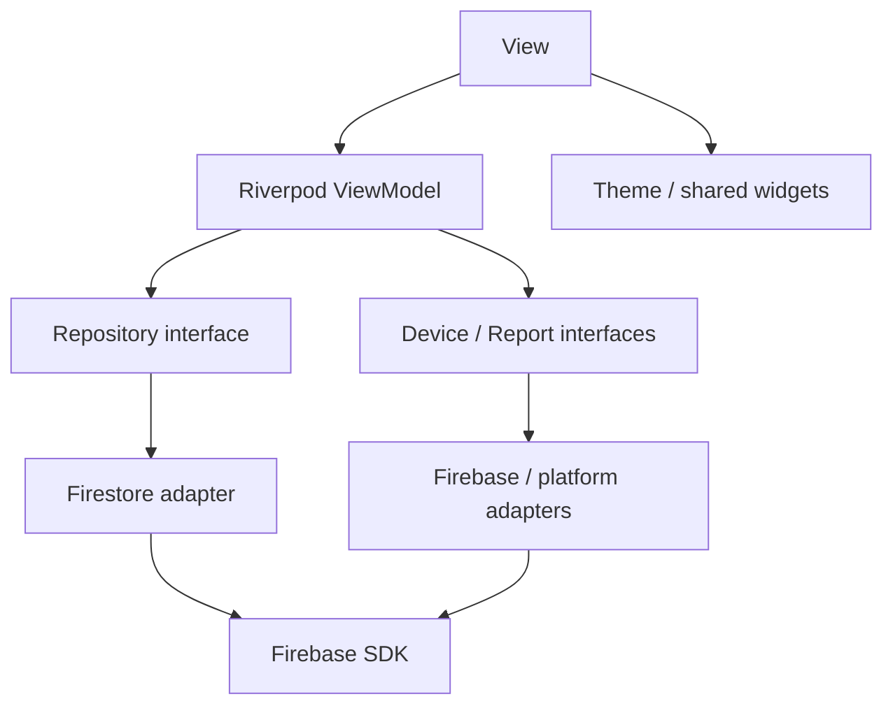
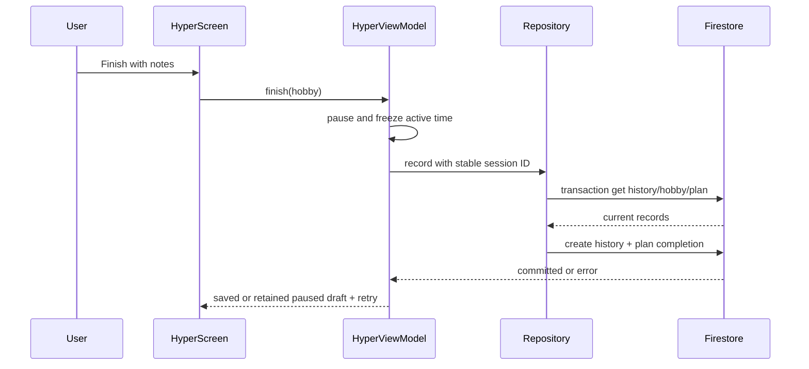

# Kiến trúc Khoảnh khắc được chốt 04/11/2026

Hosting demo được người dùng chọn 05/11/2026: Render Free Native Node 22, một Web Service, HTTPS ở proxy, Firebase/Cloudinary giữ nguyên. `render.yaml` chỉ chứa cấu hình/placeholder; secret nằm trong Environment/Secret Files. Code hỗ trợ `MOMENTS_PORT` → `PORT` → 8787, local vẫn loopback mặc định. Free sleep làm ngừng worker khi idle; chưa mặc định coi là always-on production. Trạng thái deploy/kiểm tra thật: [moments-render-free.md](moments-render-free.md).

Spotify extension (05/11): Hyper Mode panel → Riverpod SpotifyController → owner-scoped SpotifySession → AppAuth PKCE/Web API + Method/EventChannel → official Android App Remote → installed Spotify app. Không đi qua Firebase backend. Tokens memory-only; preference namespaced Firebase UID/Spotify ID; owner/generation guards chặn kết quả async cũ. Chi tiết tại [spotify-setup.md](spotify-setup.md). Người dùng yêu cầu ngoại lệ đối với shortcut-only baseline; chưa nghiệm thu âm thanh/OAuth thật.

Firebase Auth/Firestore/FCM + Node.js standalone (functions/src/server.ts) + Cloudinary authenticated assets. Flutter dùng MOMENTS_API_URL cho cả foreground và background thumbnails; không gọi Functions hay upload Firebase Storage trong đường production Khoảnh khắc. Legacy USE_FIREBASE_EMULATORS vẫn dùng adapter cũ để hồi quy. Chưa deploy hosting hoặc Rules/indexes mới, chưa thử credentials/provider thật. Chi tiết và vận hành: [moments-cloudinary-run.md](moments-cloudinary-run.md). Phần mô tả Storage/Functions trước đây bên dưới là lịch sử cho tính năng này; các flow khác không thay đổi.

# Architecture — integrated Lab3 source

MVVM/Riverpod, Android target. Views import domain models/ViewModels/shared components. Firebase/plugin calls stay in adapters/services; composition providers inject implementations.

| Folder | Responsibility |
|---|---|
| lib/models | Auth/domain typed data and validation contracts |
| lib/viewmodels | auth gate, async data providers, feature action state, active-time Hyper VM, runtime coordination |
| lib/services | repository/device/report interfaces, composition, owner-local persistence, PDF export, reminders |
| lib/firebase | Firebase Auth/Firestore/Storage/telemetry/config/messaging adapters |
| lib/features | auth, shell, hobbies, practice, community and settings views |
| lib/widgets, lib/theme | reused components/tokens/theme variants |
| firebase | deny-by-default Firestore/Storage rules and executable emulator tests |
| test, e2e_test | unit/widget fixtures and actual-device ARTEMIS suite |

| ViewModel | Injected dependencies |
|---|---|
| AuthViewModel/authSessionProvider | AuthService; identity stream + owner-profile Future gate |
| FeatureActions | HobbyRepository, DeviceServices, ReportExporter, ReportUploader |
| data providers | ownerId-scoped repository streams; Remote Config flags |
| HyperViewModel | HobbyRepository, DeviceServices, ActiveClock (Stopwatch implementation) |
| RuntimeController | DeviceServices; queued identity setup, screen tracking, reminder coordination |

UID changes invalidate repository streams and VM state. Firestore disk persistence is disabled. Session drafts checkpoint every ~5 seconds and on note/pause, restore paused, never add wall time during pause. Views keep form text on failed submit. No production sample records or local-echo chats.

Widget rendering and tests do not prove native SDK setup. See full-implementation-report.md for actual evidence and unresolved platform gates.

## UID gate and account metadata — 03/11/2026

authIdentityProvider observes Firebase userChanges. authSessionProvider selects UID changes only to bootstrap/validate the owner profile; same-account name/token/provider updates do not reopen the routing gate. currentUserProvider combines matching gate/identity UIDs for live metadata. A different UID/logout still invalidates the gate and old account data providers.

Feature actions retain typed operation/error/artifact state. The app's ScaffoldMessenger presents success as a transient 3-second SnackBar; route changes clear feedback while preserving export/upload artifacts. Views retain inline validation/retry errors, not persistent global success cards.

## Device-local language — 03/11/2026

LanguageController/LanguageStore provide injected English/Vietnamese persistence independently of account/Firebase. UI uses AppStrings delegates and localized widgets at display boundaries; raw user content remains Text. Domain error messages are translated for display, without changing Firestore identifiers, auth guard state, priorities, themes or schema. PDF exporter is constructed for the current locale; reminders read the persisted language and resync on locale changes. SDK flutter_localizations and pinned intl provide picker/date localization.

## Repository layout — 03/11/2026

Application folders lib/android/assets/firebase/test/e2e_test/scripts remain at the repository root. Requirements/reference/planning/prompts are under docs/requirements; design and handoff under docs/design; evidence under docs/evidence; report/slides under docs/submission; historical root material under docs/history. docs/README.md indexes the document set. Code/config relative paths used by Flutter/Firebase remain unchanged.

## Group moments and isolated emulator runtime — 04/11/2026

Moments views → UID-scoped Riverpod ViewModels → MomentRepository/PhotoPicker/DraftStore abstractions → Firebase Functions/Storage or platform picker. Views do not import Firebase SDK. FirebaseMomentRepository checks the current owner before/after asynchronous operations. Media is received as authenticated callable bytes into memory, without permanent Storage download URLs. Server-aligned Stopwatch time drives expiry; resuming the viewer rechecks access.

FirebaseRuntimeConfig defaults to the real native Firebase app. A debug-only dart-define selects the named hobbytracker-local app with explicit demo project options; Auth/Firestore/Storage/Functions providers all use the selected app. Google auth and cloud device services are disabled in local mode; UI displays LOCAL EMULATORS. No fixtures enter lib/. Host validation and disabled automatic Android host mapping support explicit ADB reverse or 10.0.2.2. See [local run guide](moments-local-run.md). This is source wiring, not proof of device/cloud integration.

## Moment delivery and presentation — 04/11/2026

Main bootstrap injects FirebaseMomentAlertRepository and FCM foreground transport into optional alert providers. UID-scoped MomentAlertController serializes metadata/media authorization and dedupe before a transient root banner; Hyper state defers presentation and notification navigation. Dedicated settings/inbox views use the repository contract, never SDK calls. Reference-only inbox snapshots also work with real local Firestore Emulator; disabled/missing bootstrap integration does not simulate delivery.

Data-only background messages enqueue unique WorkManager tasks. The separate Dart worker initializes the real default Firebase app, rechecks persisted/current UID, server settings/membership/expiry and then uses in-memory thumbnail bytes in a timed Android local notification. The shared local-notification response path validates owner/IDs before routing; viewer checks authorization again. Reminder sync cancels only reminder payloads in its disjoint ID space, while logout cancels owner work/notifications. See [step 3 evidence/limits](moments-alerts-step3-report.md).

## Moment cleanup and regression — 04/11/2026

MomentCleanup runs through a server maintenance lease and bounded queues. Publication/session/retraction writes cleanupPending/cleanupAfter; backfill scans older metadata with cursors. Storage adapter only lists generated namespaces and deletes matching leaves after checking generation, keeping cloud preconditions. Expiry authorization is independent of deletion. Private content fields are redacted after cleanup, minimal tombstones retained, expired inbox/outbox receipts pruned; orphan sweeps never enumerate users/ report paths.

MomentLocalRetention handles UID-scoped dedupe/index housekeeping on owner setup, foreground alert recording and worker activity. One-day local TTL uses wall time solely for housekeeping; backend time + Stopwatch still controls image access. Notification adapter rechecks owner and subtracts elapsed time after asynchronous permission work. See [step 4 evidence/limits](moments-cleanup-step4-report.md).

## Quick focus scheduling — 04/11/2026

PracticePlan schema giữ nguyên; minutes là số nguyên 1–1440. Hằng ngày/tuần được tính theo calendar date giữ local wall time rồi serialize UTC, end inclusive, max100. Không thêm recurrence documents/cron hoặc tự sinh vô hạn. FeatureActions tạo các IDs ổn định theo request ID của form; HobbyRepository.createPlans dùng transaction kiểm tra existing trước writes, tạo phần thiếu và không reset completion của ID đã tồn tại. Mỗi buổi quản lý như plan cũ. Owner-only Rules, hobbies thực, reminder và Hyper elapsed-time contract giữ nguyên. Chi tiết: quick-schedule-update.md.
