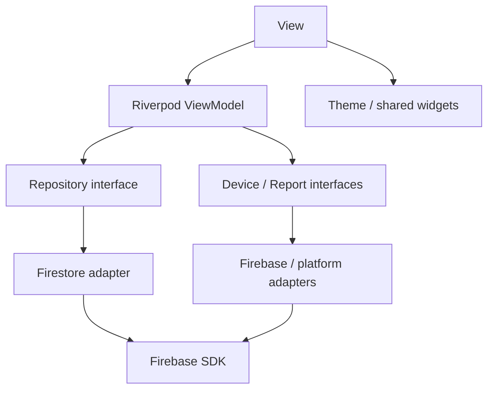
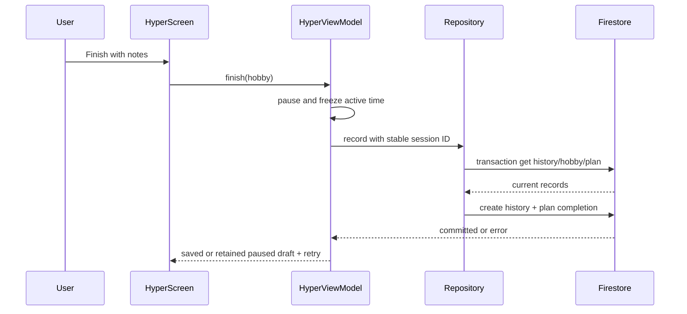

# Architecture — integrated Lab3 source

MVVM/Riverpod, Android target. Views import domain models/ViewModels/shared components. Firebase/plugin calls stay in adapters/services; composition providers inject implementations.

| Folder | Responsibility |
|---|---|
| lib/models | Auth/domain typed data and validation contracts |
| lib/viewmodels | auth gate, async data providers, feature action state, active-time Hyper VM, runtime coordination |
| lib/services | repository/device/report interfaces, composition, owner-local persistence, PDF export, reminders |
| lib/firebase | Firebase Auth/Firestore/Storage/telemetry/config/messaging adapters |
| lib/features | auth, shell, hobbies, practice, community and settings views |
| lib/widgets, lib/theme | reused components/tokens/theme variants |
| firebase | deny-by-default Firestore/Storage rules and executable emulator tests |
| test, e2e_test | unit/widget fixtures and actual-device ARTEMIS suite |

| ViewModel | Injected dependencies |
|---|---|
| AuthViewModel/authSessionProvider | AuthService; identity stream + owner-profile Future gate |
| FeatureActions | HobbyRepository, DeviceServices, ReportExporter, ReportUploader |
| data providers | ownerId-scoped repository streams; Remote Config flags |
| HyperViewModel | HobbyRepository, DeviceServices, ActiveClock (Stopwatch implementation) |
| RuntimeController | DeviceServices; queued identity setup, screen tracking, reminder coordination |

UID changes invalidate repository streams and VM state. Firestore disk persistence is disabled. Session drafts checkpoint every ~5 seconds and on note/pause, restore paused, never add wall time during pause. Views keep form text on failed submit. No production sample records or local-echo chats.

Widget rendering and tests do not prove native SDK setup. See full-implementation-report.md for actual evidence and unresolved platform gates.

## UID gate and account metadata — 03/11/2026

authIdentityProvider observes Firebase userChanges. authSessionProvider selects UID changes only to bootstrap/validate the owner profile; same-account name/token/provider updates do not reopen the routing gate. currentUserProvider combines matching gate/identity UIDs for live metadata. A different UID/logout still invalidates the gate and old account data providers.

Feature actions retain typed operation/error/artifact state. The app's ScaffoldMessenger presents success as a transient 3-second SnackBar; route changes clear feedback while preserving export/upload artifacts. Views retain inline validation/retry errors, not persistent global success cards.

## Device-local language — 03/11/2026

LanguageController/LanguageStore provide injected English/Vietnamese persistence independently of account/Firebase. UI uses AppStrings delegates and localized widgets at display boundaries; raw user content remains Text. Domain error messages are translated for display, without changing Firestore identifiers, auth guard state, priorities, themes or schema. PDF exporter is constructed for the current locale; reminders read the persisted language and resync on locale changes. SDK flutter_localizations and pinned intl provide picker/date localization.

## Repository layout — 03/11/2026

Application folders lib/android/assets/firebase/test/e2e_test/scripts remain at the repository root. Requirements/reference/planning/prompts are under docs/requirements; design and handoff under docs/design; evidence under docs/evidence; report/slides under docs/submission; historical root material under docs/history. docs/README.md indexes the document set. Code/config relative paths used by Flutter/Firebase remain unchanged.
